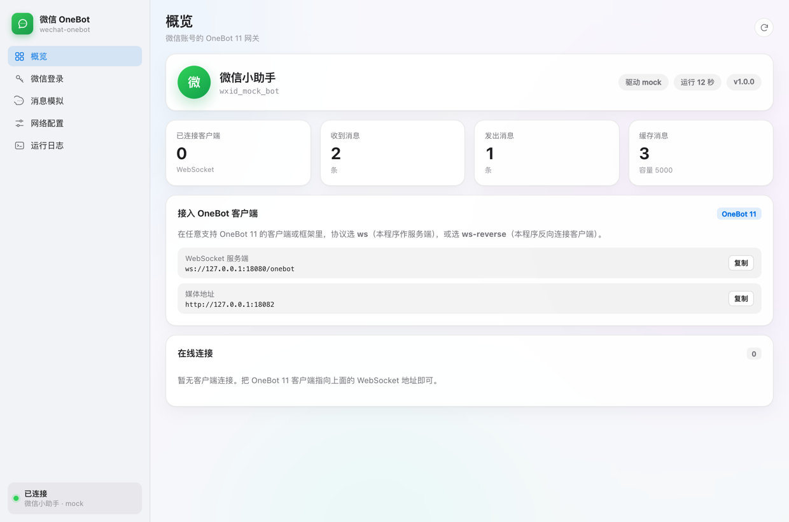
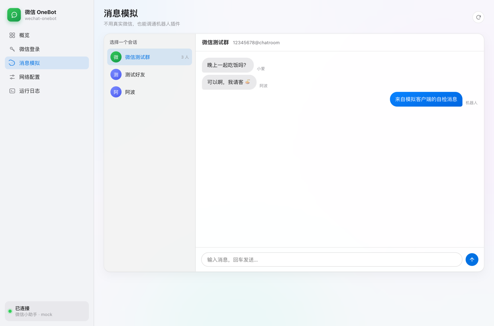
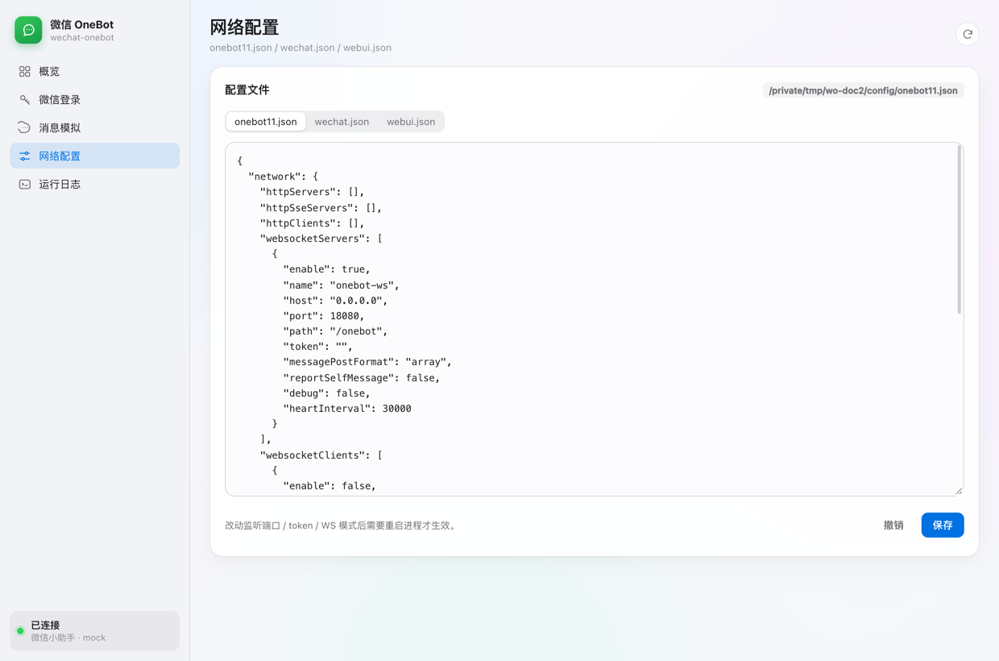
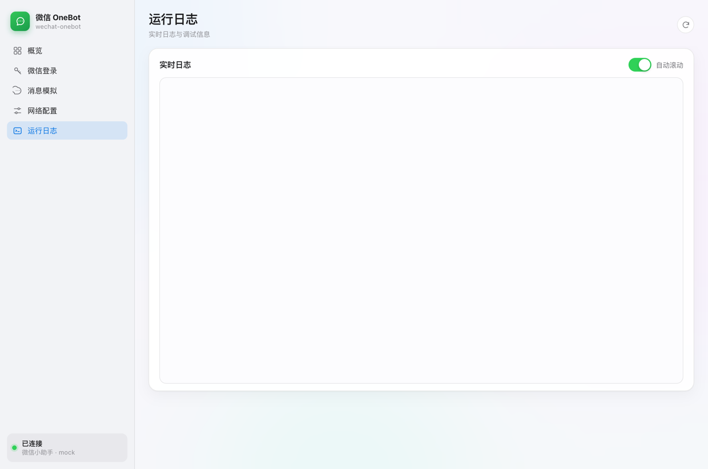
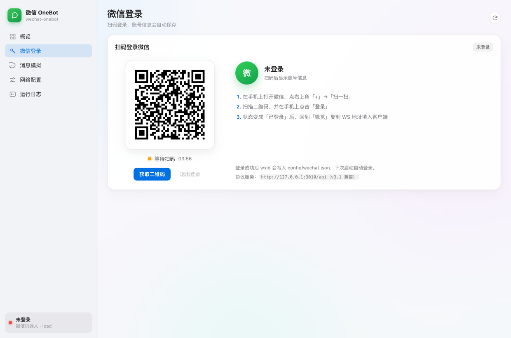

# wechat-onebot

**微信 OneBot 11 网关**：把一个微信账号包装成标准的 OneBot 11 服务，
通过 **WebSocket / HTTP** 对接任意支持 OneBot 11 的客户端或框架，不需要修改客户端。

> 本项目参考了 OneBot 11 的字段与握手约定，以及 iPad 协议接口（`ipad.swagger.yml` 与回调格式）。
> 自测使用项目自带的模拟客户端，不依赖具体聊天框架。

---

## 使用方法

### 1. 先启动（不接微信也能跑）

要求 **Python 3.10+**，无需安装依赖：

```bash
cd ~/wechat-onebot
./start.sh
```

启动后：

| 用途 | 地址 |
|---|---|
| OneBot WebSocket | `ws://127.0.0.1:3001/onebot` |
| 媒体服务 | `http://127.0.0.1:3002/media/` |
| WebUI | `http://127.0.0.1:6100`（令牌见 `config/webui.json`） |

默认是 `mock` 驱动：WebUI 的「消息模拟」和终端都能造消息，适合先把客户端/插件调通。

### 2. 接入 OneBot 客户端

- 协议：`ws`（也支持 `ws-reverse` / HTTP）
- endpoint：`ws://127.0.0.1:3001/onebot`
- token：`config/onebot11.json` 里 `websocketServers[0].token`，留空则不校验
- selfId：微信 wxid；`mock` 默认 `wxid_mock_bot`

客户端跑在 Docker 里时，把 `127.0.0.1` 换成 `host.docker.internal`。

### 3. 接入微信（三选一）

| 方式 | 适用场景 | 怎么用 |
|---|---|---|
| `ipad` 驱动 | 有可用的 iPad 协议服务 | 改 `driver=ipad`、填 `ipad.base_url`，WebUI「微信登录」或 `./start.sh --qr` |
| `bridge` 驱动 + Windows 代理 | **个人微信，推荐** | 真实 Windows 微信 4.x，按 [Windows 桥接代理](integrations/windows-wechat-ai/README.md) 接入 |
| `bridge` 驱动 + 其它 hook | 已有 WeChatFerry/自研 hook | POST `/wechat/event` 推消息，GET `/wechat/actions` 拉发送任务 |

> 如果 iPad 协议端扫码后提示「版本过低」，那是协议端被腾讯拦截，不是手机微信的问题；
> 换 Windows 代理，或让协议服务商提供适配当前微信的版本。

### 4. 常用命令

```bash
./start.sh --stop          # 停止由本程序启动的实例
./start.sh --check         # 只检查配置和端口
./scripts/start-stack.sh   # Redis + iPad 协议服务 + 网关
./scripts/doctor.sh        # 一键诊断
python3 tests/run_tests.py # 单元/集成测试
```

更细的配置、登录、接口说明见下方目录。

---

## 目录

- [这是什么 / 不是什么](#这是什么--不是什么)
- [特性](#特性)
- [界面](#界面)
- [使用方法](#使用方法)
- [接入 OneBot 客户端](#接入-onebot-客户端)
- [微信登录](#微信登录)
- [固定协议服务版本](#固定协议服务版本)
- [Windows 微信接入](#windows-微信接入)
- [微信驱动](#微信驱动)
- [配置文件](#配置文件)
- [WebUI](#webui)
- [自测](#自测)
- [已实现的 OneBot API](#已实现的-onebot-api)
- [常见问题](#常见问题)
- [项目结构](#项目结构)
- [已知限制与免责声明](#已知限制与免责声明)

---

## 这是什么 / 不是什么

| | 常见 QQ 机器人网关 | 本项目 |
|---|---|---|
| 宿主 | 依赖 QQ 客户端注入 | **不注入微信**，由「驱动」决定微信侧怎么来 |
| 协议 | OneBot 11 | OneBot 11（同一套 WS/HTTP 语义） |
| 配置 | 账号级 JSON + WebUI | `config/onebot11.json` / `wechat.json` / `webui.json` |
| WebUI | 有 | 有 |
| 对接客户端 | OneBot 适配器 | 任意 OneBot 11 客户端（ws / ws-reverse / http） |

**它不是**一个从零逆向的微信协议端。微信没有像 QQ 那样容易 hook 的公开客户端，所以本项目把「微信怎么连」抽象成驱动：

1. `mock` —— 本地模拟微信，**开箱即用**，用来调通机器人插件、验证消息格式；
2. `ipad` —— 对接 iPad 协议 HTTP 服务（常见 iPad 协议端使用的那套，`/Msg/SendTxt`、`/Friend/GetContractList` 等）；
3. `bridge` —— 通用 Webhook 桥，任何微信 hook 程序（WeChatFerry / ntchat / 自研协议端）用 HTTP 推消息、拉发送任务。

---

## 特性

- **零第三方依赖**：只用 Python 标准库，自带 RFC6455 WebSocket 服务端/客户端，不需要 `pip install`
- **三种接入方式**：正向 WS（本程序当服务端）、反向 WS（本程序连客户端）、HTTP API + HTTP 事件上报
- **OneBot 11 消息段/CQ 码**：文本、图片、语音、视频、文件、@、引用（按驱动能力降级）
- **完整的事件**：消息、自身消息、撤回、入群/退群、管理员变更、禁言、戳一戳、好友/群请求、心跳、生命周期
- **微信扫码登录**：WebUI 里扫码、终端 `./start.sh --qr`，登录后自动保存 wxid、自动心跳、下次启动二次登录
- **消息缓存**：`get_msg`、`get_group_msg_history`、`delete_msg` 可用；OneBot `message_id` 与微信消息 ID 双向映射，并按平台 ID 自动去重
- **媒体服务**：驱动收到的图片/语音落内存，转成 `http://…/media/<hash>` 给客户端拉取
- **苹果风格 WebUI**：状态、接入地址、模拟聊天、配置编辑、实时日志（SSE）
- **可自测**：`tests/run_tests.py`（15 个用例）与 `tools/mock_client.py`，都不碰真实客户端
- **排障友好**：启动前端口预检、PID 单实例、`--stop`、`scripts/doctor.sh`，关键端点起不来会直接失败而不是半启动

---

## 界面

苹果（macOS Sonoma）风格，纯 HTML/CSS/JS，无 CDN、离线可用，自动跟随系统深浅色：

| 概览 | 消息模拟 |
|---|---|
|  |  |

| 网络配置 | 运行日志 |
|---|---|
|  |  |

| 微信登录 |
|---|
|  |

<sub>截图里的 18080 等端口是演示实例，实际端口以「概览」页显示为准。</sub>

---

## 接入 OneBot 客户端

任何支持 OneBot 11 的客户端或框架都可以接入。添加一个 bot / 连接配置，按下面三种模式之一填写即可。

### 模式 A：正向 WebSocket（推荐，最简单）

本程序监听，客户端主动连进来。

- 协议：`ws`
- endpoint：`ws://127.0.0.1:3001/onebot`
- selfId：你的微信 wxid（mock 驱动默认是 `wxid_mock_bot`）
- token：与 `config/onebot11.json` 里 `websocketServers[0].token` 一致（留空则都不校验）
- 客户端跑在 Docker 里时，`endpoint` 不能用 `127.0.0.1`，要写 `ws://host.docker.internal:3001/onebot`

配置文件对应位置：

```json
"websocketServers": [
  {
    "enable": true,
    "name": "onebot-ws",
    "host": "0.0.0.0",
    "port": 3001,
    "path": "/onebot",
    "token": "",
    "messagePostFormat": "array",
    "reportSelfMessage": false,
    "heartInterval": 30000
  }
]
```

### 模式 B：反向 WebSocket

客户端开 `ws-reverse` 服务端（默认路径 `/onebot`），本程序连过去。把正向 WS 关掉，开启反向 WS：

```json
"websocketServers": [ { "enable": false, "...": "..." } ],
"websocketClients": [
  {
    "enable": true,
    "name": "onebot-ws-reverse",
    "url": "ws://127.0.0.1:5140/onebot",
    "token": "与客户端侧 token 一致（可空）",
    "messagePostFormat": "array",
    "reportSelfMessage": false,
    "reconnectInterval": 3000,
    "heartInterval": 30000
  }
]
```

本程序会带上标准 OneBot 11 握手头：`X-Self-ID: <wxid>`、`X-Client-Role: Universal`、`Authorization: Token <token>`。

> 注意：`5140` 是常见的反向 WS 监听端口，请不要和本程序的正向 WS 端口（默认 3001）冲突。

### 模式 C：HTTP

```json
"httpServers": [
  { "enable": true, "name": "api", "host": "0.0.0.0", "port": 5700, "token": "your-token" }
]
```

- OneBot HTTP API：`POST http://127.0.0.1:5700/<action>`，请求头 `Authorization: Bearer <token>`
- 事件上报（本程序推给别的服务）：`network.httpClients`，支持 `secret` HMAC-SHA1 签名（`X-Signature: sha1=...`）

### 关于 `selfId`

- 客户端的 `selfId` 请填**微信 wxid**。`ipad` 驱动会在第一次收到回调时自动学习 wxid；`mock` 默认 `wxid_mock_bot`
- WebUI「概览」页会直接显示当前账号，照着填即可

---

## 微信登录

`mock` / `bridge` 驱动不需要登录。`ipad` 驱动第一次使用（或退出登录后）需要扫码：

### 方式一：WebUI（推荐）

1. `config/wechat.json` 里把 `driver` 设为 `ipad`，填好 `ipad.base_url`（协议服务地址）
2. 启动 `./start.sh`，打开 WebUI → 「微信登录」
3. 点「获取二维码」（进入页面也会自动获取），用手机微信扫码并在手机上确认
4. 状态变成「已登录」后，账号 wxid / 昵称自动显示，并写入 `config/wechat.json`

### 方式二：终端

```bash
./start.sh --qr
```

会调用协议服务取码，把二维码保存成 `config/login-qr.png` 并在 macOS 上自动打开「预览」，
然后每 2 秒轮询状态；登录成功后同样把 wxid 写回配置。不想自动打开图片就加 `--no-open`：

```bash
./start.sh --qr --no-open
```

### 登录之后

- 自动登录：下次启动会调 `LoginTwiceAutoAuth` + `HeartBeat`，不需要重复扫码
- 心跳：默认每 25 秒一次；连续 3 次失败会标记为未登录，需要重新扫码（间隔可在 `ipad.login.heartbeat_sec` 调）
- 退出登录：WebUI「微信登录」→「退出登录」，会调协议服务 `Login/LogOut` 并清空本地登录态
- 客户端的 `selfId` 请填扫码后的 wxid（WebUI 上会显示），否则事件里的 `self_id` 会和客户端配置不一致

登录相关配置：

```json
"ipad": {
  "base_url": "http://127.0.0.1:3010",
  "wxid": "",
  "login": {
    "auto_login": true,
    "device_name": "wechat-onebot",
    "login_type": "ipad",
    "heartbeat_sec": 25
  }
}
```

> `LoginCheckQR` 的返回在不同版本里可能是 ticket 字符串或对象；本程序以 `acctSectResp.userName` 作为登录成功判据，
> 其余状态统一显示为「等待扫码 / 等待手机确认」。

---

## 固定协议服务版本

`wechat-ipad:latest` 已经升级到 v3.2.x，启用了**内部请求签名**，容器启动时强制要求
`ROBOT_CODE`、`ROBOT_AUTH_KEY_ID` 以及两个 32 字节的 base64 密钥；而现有管理后台创建容器时不会传这些变量，
所以 `latest` 容器会 `panic` 并无限重启，WebUI 也就取不到二维码。

本项目固定使用 **v3.1.1**（内部鉴权引入之前、且与公开客户端/本驱动接口兼容的版本）：

| 项目 | 值 |
|---|---|
| 镜像 tag | `registry.cn-shenzhen.aliyuncs.com/houhou/wechat-ipad:v3.1.1` |
| 镜像摘要 | `sha256:41161d425d5130cfb254811aef7a87bc790a7abefbc471918ecbdfaf77f885c6` |
| 平台 | `linux/amd64` |
| 容器 | `wechat-ipad-v311` |
| 端口 | `3010 -> 9000` |
| 重启策略 | `unless-stopped` |

另外已经把管理后台数据库 `robot_admin.robot.docker_image` 改成 `v3.1.1`，
这样后台重建机器人时也会使用固定版本，而不会回到 `latest`。

```bash
# 按固定摘要重建协议服务（推荐，镜像 tag 被重新指向也不受影响）
./scripts/recreate-wechat-ipad.sh

# 日常启动：Redis → 协议服务 → wechat-onebot
./scripts/start-stack.sh

# 出问题时先跑一次诊断（容器、镜像、端口、网关、登录状态）
./scripts/doctor.sh
```

### 版本兼容

| 差异 | v3.1.x（固定使用） | v3.2.x（latest） | 本程序的处理 |
|---|---|---|---|
| 成功码 | `Code: 1` | `Code: 0` | 以 `Success` 为准，0/1 都接受 |
| 二维码字段 | `QrBase64` / `QrUrl` | `QRCodeBase64` / `QRCodeURL` | 都识别，并在登录状态里标记 `protocol: legacy / v3` |
| 二维码过期 | 日期字符串 `2026-10-28 18:10:19` | 秒数 | 都解析；解析异常时按 120 秒兜底 |
| 登录轮询 | `uuid` / `status` / `expiredTime` | 同左 | `status=0` 等待、`>0` 已扫码、`acctSectResp.userName` 才算成功 |
| 内部鉴权 | 无 | 需要 `ROBOT_AUTH_*` | 不兼容，所以固定 v3.1.1 |

> 回调地址固定写成 `host.docker.internal:9002`，指向 wechat-onebot 的回调服务。
> 如果由管理后台重建容器，它传的 `WECHAT_CLIENT_HOST` 会指向 `client_xxx:9000`，
> 这时需要把回调改回 `host.docker.internal:9002`，否则收不到消息。

---

## Windows 微信接入

如果 iPad 协议端被腾讯拦截，可以在**真实 Windows 10/11** 上运行微信 4.x，用
[Windows 桥接代理](integrations/windows-wechat-ai/README.md) 接入本网关的 `bridge` 驱动。
代理走 UIA 自动化，不做协议登录；需要一台 Windows 电脑、Parallels/UTM 虚拟机或 Windows VPS。

---

## 微信驱动

在 `config/wechat.json` 的 `driver` 字段选择：`mock` / `ipad` / `bridge`。改完需要重启进程。

### 1. `mock`（默认，无需微信）

- 内置好友（小爱、阿波）与「微信测试群」，可在 `wechat.mock.friends` / `wechat.mock.groups` 里改
- 支持收发文本/图片标记、群管理（禁言、踢人、名片、群名等）
- 终端控制台：`g <群> <内容>`、`f <好友> <内容>`、`ls`、`help`
- WebUI「消息模拟」与它共用一套数据

### 2. `ipad`（需要 iPad 协议服务）

对接你已有的 iPad 协议服务（`wechat-robot-client` 用的那种），走 HTTP：

```json
"driver": "ipad",
"ipad": {
  "base_url": "http://127.0.0.1:3010",
  "api_prefix": "/api",
  "wxid": "你的wxid",
  "timeout": 20,
  "callback_path_prefix": "/api/v1/wechat-client",
  "refresh_contacts_sec": 300,
  "max_contact_batches": 10
}
```

- **登录**：`/Login/LoginGetQR`（取码）、`/Login/LoginCheckQR`（轮询）、`/Login/HeartBeat`（心跳）、`/Login/LoginTwiceAutoAuth`（二次登录）、`/Login/LogOut`
- **出方向**：`/Msg/SendTxt`、`/Msg/UploadImg`、`/Msg/Revoke`、`/Friend/GetContractList`、`/Friend/GetContractDetail`、
  `/Group/GetChatRoomMemberDetail`、`/Group/DelChatRoomMember`、`/Group/SetChatRoomName`、`/Group/OperateChatRoomAdmin`、`/Group/Quit`
- **入方向**：把协议服务的回调地址指向本程序的回调端口（默认 `9002`），支持两种格式：
  - `POST /api/v1/wechat-client/{wxid}/sync-message`，body 为 `{ "Data": { "AddMsgs": [...] } }`（与 `wechat-robot-client` 路由一致）
  - `POST /callback`，body 为 `{ "TypeName": "AddMsg", "Wxid": "...", "Data": { ... } }`（与 `message_callback.md` 一致）
- 解析了文本、图片（`ImgBuf.buffer` 缩略图）、语音、视频、表情、文件/链接卡片、引用（`refermsg`）、撤回、戳一戳、入群/退群提示
- 媒体会转成 `http://<本机>:3002/media/...`（`wechat.media.public_base` 可改；客户端跑在 Docker 里时务必改成容器可访问的地址）
- `wxid` 建议在 `wechat.json` 里填好；即使不填，第一次回调学到 wxid 后也会自动重连反向 WS，让 `X-Self-ID` 保持正确

> 这套 iPad 协议是第三方商业服务（`wechat-ipad` 镜像），本项目只按它公开的 Swagger/回调文档适配。
> 我用本地桩服务把「回调 → OneBot 事件 → 发消息」全链路测过，但**没有**连你的真实协议服务，
> 不同版本字段可能有差异，日志会打印原始返回便于调整。当前驱动只稳定支持**文本 + 图片**发送。

### 3. `bridge`（任意微信 hook）

任何 hook 程序只要会说 HTTP，就能接：

```json
"driver": "bridge",
"bridge": {
  "account": { "wxid": "wxid_bot", "nickname": "微信桥" },
  "token": "",
  "action_callback_url": "",
  "action_timeout": 30
}
```

入方向（hook → 本程序）：

```bash
curl -X POST http://127.0.0.1:9002/wechat/event -d '{
  "type": "message",
  "chat_type": "group",
  "chat_id": "123456@chatroom",
  "user_id": "wxid_xiaoai",
  "nickname": "小爱",
  "text": "你好"
}'
```

也支持完整写法（`segments` 数组、`platform_id`、`is_self`、`quote_platform_id`），以及 `type: "notice"` / `"request"` / `"sync"`。

出方向（本程序 → hook）：

- 有 `action_callback_url`：直接 POST 任务并等 JSON 结果
- 没有：hook 用长轮询取任务

```bash
curl "http://127.0.0.1:9002/wechat/actions?wait=25"
# {"tasks":[{"id":1,"action":"send_message","chat_type":"group","chat_id":"...","segments":[...]}]}

curl -X POST http://127.0.0.1:9002/wechat/actions/result \
  -d '{"id":1,"ok":true,"platform_id":"123456"}'
```

`GET /wechat/state` 可查看桥接状态。

---

## 配置文件

三份文件都在 `config/`，首次运行自动生成，WebUI 里也能直接改（保存后可能需要重启）。

### `config/onebot11.json`

| 字段 | 说明 |
|---|---|
| `network.websocketServers[]` | 正向 WS：`host` `port` `path` `token` `messagePostFormat` `reportSelfMessage` `heartInterval` |
| `network.websocketClients[]` | 反向 WS：`url` `token` `reconnectInterval` 等 |
| `network.httpServers[]` | HTTP API：`host` `port` `token` |
| `network.httpClients[]` | 事件 HTTP 上报：`url` `secret` `timeout` |
| `network.httpSseServers[]` | 预留（当前未实现 SSE 模式，留空即可） |
| `enableLocalFile2Url` | 是否启动媒体服务（默认 `true`） |
| `messagePostFormat` | `array`（默认，推荐）或 `string`（CQ 码） |
| `reportSelfMessage` | 是否把机器人自己发的消息也作为 `message_sent` 事件上报（默认 `false`） |

### `config/wechat.json`

| 字段 | 说明 |
|---|---|
| `driver` | `mock` / `ipad` / `bridge` |
| `account.wxid` / `account.nickname` | 账号信息（`mock` 用它覆盖默认值） |
| `callback` | 驱动回调 HTTP 服务：`enable` `host` `port` |
| `media` | 媒体服务：`enable` `port` `public_base`（对外地址） |
| `mock` | 模拟数据：`interactive`、`friends`、`groups` |
| `ipad` | iPad 协议服务地址、wxid、超时、回调路径前缀 |
| `bridge` | 桥接账号、`action_callback_url`、`token`、`action_timeout` |

### `config/webui.json`

| 字段 | 说明 |
|---|---|
| `enable` | 是否启用 WebUI |
| `host` / `port` | 默认 `0.0.0.0` / `6100` |
| `token` | 登录令牌，首次运行随机生成；**留空则无需登录**（仅建议本机使用） |

---

## WebUI

打开 `http://127.0.0.1:6100`，令牌在 `config/webui.json`。

- **概览**：账号、驱动、运行时长、收发统计、可复制的 WS/HTTP/媒体地址、在线连接列表
- **消息模拟**：mock 驱动下选会话、发消息，机器人回复实时以 iMessage 风格气泡展示
- **网络配置**：直接编辑三份 JSON 并保存（含路径提示与「需重启」提示）
- **运行日志**：SSE 实时日志，级别着色，可开关自动滚动

界面是苹果（macOS Sonoma）风格：系统字体、毛玻璃侧边栏、红黄绿交通灯、分段控件、iOS 开关、自动深色模式；
纯 HTML/CSS/JS，无 CDN 依赖，离线可用。

---

## 自测

```bash
# 单元 + 集成测试（不连真实客户端、不连真实微信）
python3 tests/run_tests.py

# 模拟 OneBot 11 客户端（自检脚本）
python3 tools/mock_client.py --url ws://127.0.0.1:3001/onebot --demo
python3 tools/mock_client.py --url ws://127.0.0.1:3001/onebot   # 交互：api / send / quit
```

`tests/run_tests.py` 覆盖：

1. CQ 码 / 消息段编解码与 @ 拆分
2. 零依赖 WebSocket 帧收发、关闭
3. 正向 WS 全流程：生命周期、`get_login_info`、注入消息、`send_group_msg`、`message_sent`、群列表/成员、`get_msg`、`delete_msg`、未知 API
4. token 校验
5. OneBot HTTP API + HTTP 事件上报（含签名头）
6. 反向 WS：`X-Self-ID` / `X-Client-Role` / `Authorization`、生命周期、API 往返
7. WebUI：登录、状态、mock 数据、模拟消息、事件流
8. iPad 驱动：本地桩协议服务 → 回调解析（文本/@/图片）→ 媒体 URL → 发文本请求体
9. 微信扫码登录：取码、轮询到成功、账号写回、退出登录
10. v3.1.1 旧版响应：`Code=1`、`QrBase64`、日期过期时间、`status=0/2`
11. 启动前端口预检（占用时给出进程）
12. WebUI 端口被占用时 `Gateway.start` 抛 `StartupError`，不会半启动
13. Webhook 桥：事件入站、任务长轮询、结果回填

---

## 已实现的 OneBot API

`send_msg` `send_private_msg` `send_group_msg` `delete_msg` `get_msg` `get_login_info` `get_status`
`get_version_info` `get_friend_list` `get_group_list` `get_group_info` `get_group_member_info`
`get_group_member_list` `get_stranger_info` `can_send_image` `can_send_record` `get_image` `get_record`
`mark_msg_as_read` `clean_cache` `reload_event_filter` `set_restart` `get_group_msg_history`
`get_friend_msg_history` `set_group_card` `set_group_ban` `set_group_whole_ban` `set_group_kick`
`set_group_leave` `set_group_name` `set_group_admin` `set_friend_add_request` `set_group_add_request`
`upload_group_file` `upload_private_file` `get_online_clients` `get_group_at_all_remain`

驱动不支持的动作返回 `retcode = 1404`（不影响客户端启动，插件调用时会收到明确错误）。

---

## 常见问题

**客户端连不上 / 401**
检查 `token` 是否与 `onebot11.json` 一致；正向 WS 时客户端发的是 `Authorization: Bearer <token>`，本程序也接受 `?access_token=`。

**启动时提示端口被占用 / 只启动了一半**
新版启动前会检查所有监听端口并直接退出（exit code 2），列出占用进程；
网关启动后如果 WebUI、回调服务或所有 OneBot 端点起不来，会抛 `StartupError` 退出，不再"看似就绪、其实不可用"。

```bash
./start.sh --stop      # 按 run/gateway.pid 停止旧实例
./start.sh --check     # 只检查配置和端口
./scripts/doctor.sh    # 一键诊断
```

**端口被占用**
系统里其他服务可能占用 `3001`、`6099`、`5140`。本程序 WebUI 默认 `6100`；如仍冲突，改 `onebot11.json` 的 `port` 或 `webui.json` 的 `port`，或用
`--config-dir` 起一套独立配置。

**图片在客户端里裂开**
媒体服务默认给出 `http://127.0.0.1:3002/media/...`。客户端跑在 Docker 里时把 `wechat.media.public_base`
改成容器能访问的地址（例如 `http://host.docker.internal:3002`），并确认 `enableLocalFile2Url` 为 `true`。

**消息重复**
本程序按平台消息 ID 去重；如果你同时开了 `reportSelfMessage` 又让插件回复自身消息，看起来会像「重复」，
把 `reportSelfMessage` 关掉即可。iPad 协议服务重复推送同一条消息也会被去重。

**客户端显示离线**
`get_login_info` 必须成功。检查驱动是否 `online`（WebUI 概览），以及 `selfId` 是否与 webui 显示的账号一致。

**iPad 容器一直重启（ROBOT_AUTH_KEY_ID / 内部鉴权）**
`wechat-ipad` 新镜像（v3.2+）启用了内部请求签名，必须有 `ROBOT_AUTH_KEY_ID` 和两个 32 字节 base64 密钥；
而当前管理后台创建容器时不会传这些变量，于是容器 `panic` 重启。可选：
- 使用 `wechat-ipad:v3.1.1`（本机已验证可用，接口与该驱动兼容，成功码为 1 也能识别）
- 或从商家/后台获取新版权限参数后自行注入环境变量

**扫码后客户端显示离线**
把客户端配置里的 `selfId` 改成 WebUI「微信登录」里显示的 wxid，然后重启/重连该 bot；
`get_login_info` 会在登录成功后返回真实 wxid。

**iPad 回调收不到**
确认协议服务的回调地址指向 `http://<本机>:9002`；如果它推送的路径不是 `/api/v1/wechat-client/{wxid}/sync-message`，
本程序的 `POST /callback` 与 `POST /` 也能兜底。日志会打印收到的原始 JSON。

---

## 项目结构

```
wechat-onebot/
├── start.sh                     # 启动脚本
├── config/                      # 首次运行生成（onebot11.json / wechat.json / webui.json）
├── src/wechat_onebot/
│   ├── __main__.py              # 命令行入口
│   ├── config.py                # 配置加载/原子保存
│   ├── logger.py                # 控制台 + 环形缓冲 + SSE 订阅
│   ├── wsproto.py               # 零依赖 RFC6455（服务端/客户端）
│   ├── httpkit.py               # HTTP 请求/响应/SSE 基础
│   ├── httpserver.py            # 极简 asyncio HTTP 服务器
│   ├── gateway.py               # 网关：网络端点、广播、媒体、心跳
│   ├── actions.py               # OneBot 11 API 分发
│   ├── events.py                # OneBot 11 事件构造
│   ├── preflight.py             # 启动前端口/PID 检查与 --stop
│   ├── segments.py              # 消息段 / CQ 码
│   ├── store.py                 # 消息缓存与 ID 映射
│   ├── model.py                 # 内部数据模型
│   ├── webui.py                 # WebUI 后端
│   ├── static/                  # 苹果风格前端（index.html / style.css / app.js）
│   └── drivers/
│       ├── base.py              # 驱动基类
│       ├── mock.py              # 本地模拟微信
│       ├── ipad.py              # iPad 协议
│       ├── ipad_login.py        # iPad 协议登录（二维码/心跳/二次登录）
│       └── bridge.py            # 通用 Webhook 桥
├── scripts/
│   ├── recreate-wechat-ipad.sh  # 按固定摘要重建 v3.1.1 协议服务
│   ├── start-stack.sh           # Redis + 协议服务 + 网关 一键启动
│   └── doctor.sh                # 环境/端口/登录状态诊断
├── tools/mock_client.py         # 模拟 OneBot 客户端的自检脚本
└── tests/run_tests.py           # 11 个自测用例
```

---

## 已知限制与免责声明

- 本项目**不包含**微信协议逆向实现；`mock` 之外的能力取决于你接入的协议端
- iPad 驱动按公开文档适配，发送侧目前稳定支持文本与图片；禁言、全员禁言等接口该协议未开放，会返回 1404
- 微信个人号自动化存在账号风险，请遵守微信软件许可协议与当地法律法规；因使用产生的后果由使用者自行承担
- 本项目仅用于学习研究与个人自动化，请勿用于商业群发、骚扰或其他违规用途

---

参考对照：OneBot 11 协议字段与握手方式、`wechat-robot-client` 与 `ipad.swagger.yml`（iPad 协议接口与回调格式）。
